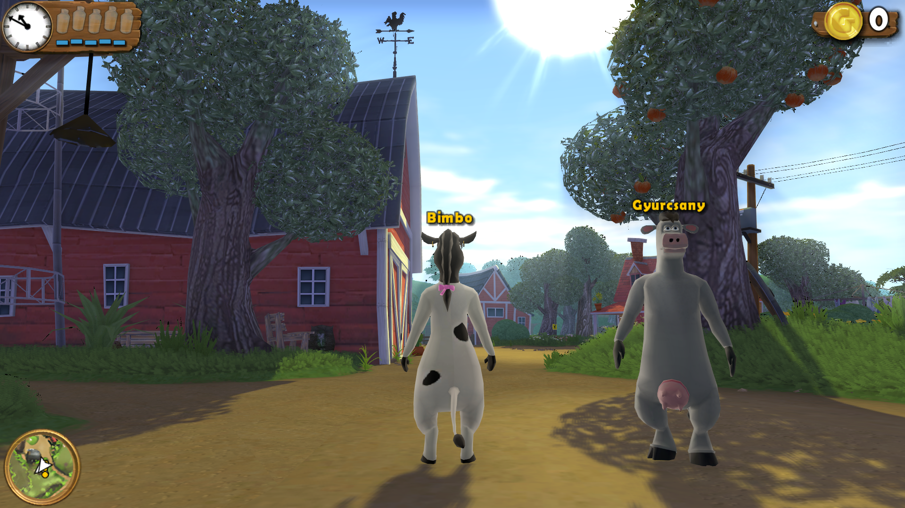
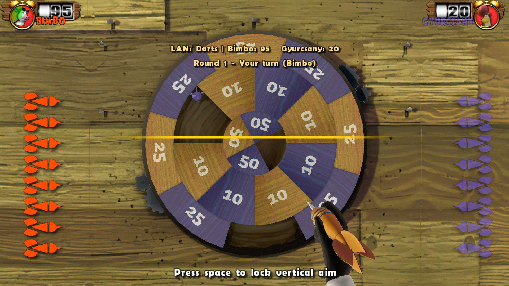
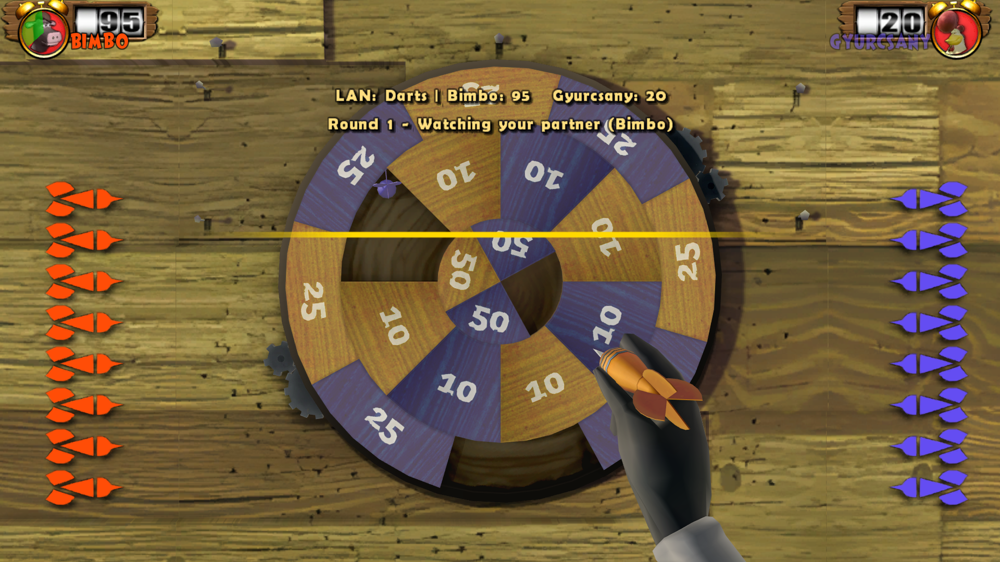

# Barnyard Remaster

**A DirectX 11 fan remaster of the 2006 Barnyard PC game for Windows and Linux (via Proton).** Play the original story with soft sun shadows, wind in the grass and trees, and optional HD textures built from your copy of the game. Share a camera on the couch or explore the farm from two computers. We also added two-player LAN modes to 14 of the original game's single-player minigames.

[**Download the patch**](https://github.com/mannin1337/barnyard-remaster/releases/latest) · [Install and transfer saves](RemasterTools/Patch/INSTALL.md) · [Graphics and shadows](#directx-11-shaders-and-shadows) · [Couch and LAN co-op](#play-together)

## DirectX 11, shaders and shadows

- **Sunlight and local lights.** Outdoors, trees, buildings and characters cast soft-edged sun shadows. Three filtered shadow maps cover the ground from near the camera into the distance, at up to 4096 × 4096 per map. Sun shadows fade at night. The bike headlamp can cast shadows of its own, and bloom gives glowing lamps and windows a halo.
- **Depth and atmosphere.** Choose HBAO or GTAO ambient occlusion for contact shading where surfaces meet. Sun shafts appear around the visible sun, while volumetric fog picks up sunlight and shadow. These controls are under **Options → Effects**.
- **Wind and vegetation.** Grass tips bend in gusts, and leaf shaders add sway and flutter to foliage on the farm. Under **Options → Detail** you can change the farm's draw distance and grass density.
- **Display and filtering.** Under **Options → Graphics** you can set the resolution, display mode, refresh rate, frame-rate cap and V-Sync. Supported hardware offers up to 8× MSAA for smoother edges and 16× anisotropic filtering for clearer ground textures at a distance. The patch includes 235 precompiled DirectX 11 shaders. [DX11 effects source](OpenBarnyard/Source/Platform/DX11/Effects) · [Shader manifest](RemasterTools/Patch/shader-hashes.json)

### Optional HD textures

The patch starts with the original artwork. The HD builder uses your game files to create **1,864 higher-resolution textures** in the farm's original colour palette. Grass, soil, leaves and bark get extra surface detail, and Otis gets a subtle coat texture on his neck and torso. Build the textures, switch on **Options → Graphics → HD Textures**, then restart the game. [Build the HD textures](Tools/hd/README.md)

## Play the story

Install the patch using your own copy of the original two-disc Barnyard PC game. On Windows, launch `Play_Barnyard.bat` and start or load your game. On desktop Linux or Steam Deck, add `OpenBarnyard/OpenBarnyard.exe` to Steam and select Proton. You can choose Xbox or PlayStation button prompts and play in English or with the optional Hungarian translation. [Installation and save transfer](RemasterTools/Patch/INSTALL.md) · [Linux and Steam Deck setup](RemasterTools/Patch/INSTALL.md#play-on-linux-with-steam-and-proton)

## Play together

For LAN, both players need the same remaster release and a connection to the same local network. Either computer can host.

| Your setup | How to start |
| --- | --- |
| **One PC, one screen** | Connect a controller for player two. In the main menu, choose **Co-op → Same Screen**, then start or load a game. Player one can use the keyboard and mouse or another controller. |
| **Two computers on LAN** | In the main menu, one player chooses **Co-op → Host LAN Game** and the other chooses **Co-op → Join LAN Game**. Start or load a game on each computer. The guest finds the host automatically. |

On LAN you can see each other on the farm and inside the barn when you're in the same area. One player can head indoors while the other stays outside. You each keep your own save and play the story missions in your own game. The game uses each cow's saved name, and you can choose a different display name for a session. [Choose your co-op names](RemasterTools/Patch/INSTALL.md#choose-your-co-op-names)

### Couch co-op on one screen

In **Same Screen**, one camera keeps both cows in view. Here Bimbo and Gyurcsany are inside the barn together.

### LAN co-op from both players' screens

The two screenshots in each row come from the same LAN session. On the farm, Bimbo looks toward the red barn while Gyurcsany looks back toward the open shed. In Darts, both players can see the orange dart in Bimbo's hand before the fifth throw. Both scoreboards read 95–20.

| Bimbo's screen (host) | Gyurcsany's screen (guest) |
| --- | --- |
| **Farm**  | **Farm**  |
| **Darts · aiming**  | **Darts · spectating**  |

## Challenge a friend

All 14 activities below are playable solo in the original PC game. For this remaster, we built a LAN mode for each one. Depending on the game, you compete in the same arena, watch each other's turns, or compare scores and finish times. On the farm, open the **pause menu → LAN Minigames**. Either player can invite the other. Accept the invitation to start, or choose **Next page** to browse the games.

| How you play | Minigames |
| --- | --- |
| Jump and kick in the same arena, alongside two AI opponents | **Mud Jumpers** |
| Take turns on the same board or table and watch your partner's shot | **Darts**, **Barnyard Pool** |
| Play a turn on your own computer while your partner spectates, then swap | **Gopher Golf**, **Chicken Launch**, **Whack-a-Rac** |
| Play the same challenge on each computer and compare scores | **Tease the Mailman**, **Tease Mrs. Beady**, **Chasing Chicks**, **Vegetable Patch Defender**, **Cow Tipping**, **Milk Bar** |
| Race on each computer and compare finish times | **Bike Race**, **Joy Ride** |

When you play as the guest, you can lock both Darts aim bars, start a Pool shot or jump in Mud Jumpers while your input is still travelling to the host. The host settles shared hits and scores. [Input timing and LAN playtest results](docs/multiplayer-testing.md#lan-input-timing-in-v55-lan5)

| Darts | Gopher Golf |
| --- | --- |
|  |  |

Each screenshot is a native 1920×1080 game frame with HD textures, 8× MSAA, 16× anisotropic filtering and the highest detail and shadow settings.

## Build and test

For developers, the source includes the Win32 DX11 build scripts and the LAN regression tests. The playtest notes record how the host and guest behaved under different frame rates, latency and packet loss. [Build from source](BUILDING.md) · [Run the LAN tests](Tools/tests/netplay/README.md) · [Multiplayer playtest results](docs/multiplayer-testing.md)

## Credits

Blue Tongue Entertainment developed Barnyard and the TOSHI engine. This fan remaster builds on the OpenBarnyard and OpenToshi decompilation work by AdventureT and InfiniteC0re. The upstream license credits THQ Nordic as the owner of TOSHI. [License](License.md) · [Upstream project and credits](README.upstream.md)
