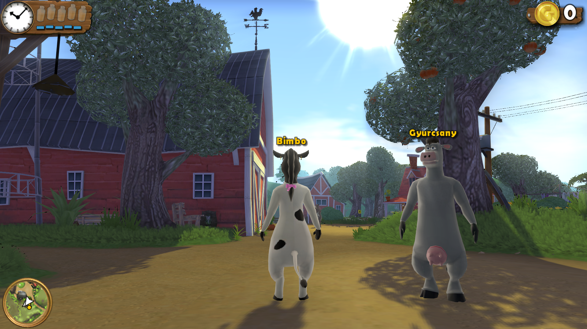
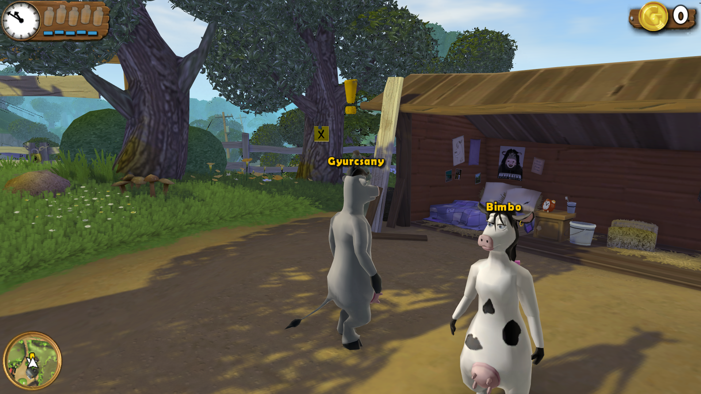
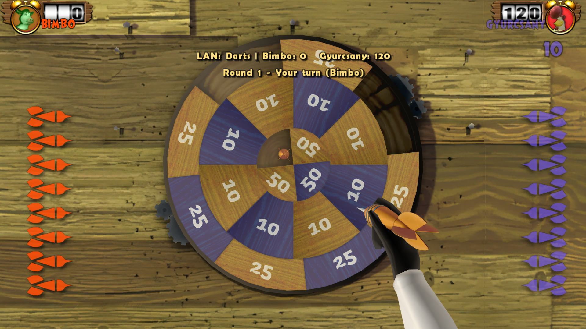
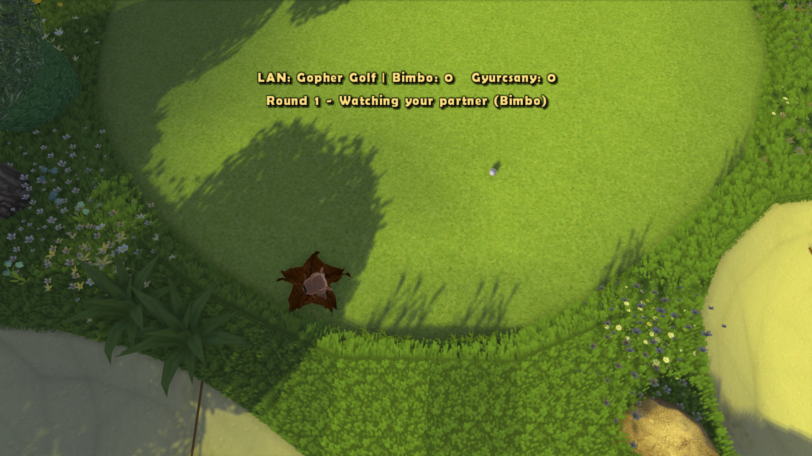

# Barnyard Remaster

**Two-player co-op for the original Barnyard PC game.** Share a camera on the couch, or explore the farm over LAN with a camera of your own. Take turns at the dartboard, jump into the same Mud Jumpers arena, or pick another challenge from the 14 LAN minigames. Either computer can host.

[**Download the patch for Windows and Linux (Proton)**](https://github.com/mannin1337/barnyard-remaster/releases/latest) · [Install and transfer saves](RemasterTools/Patch/INSTALL.md)

## Play together

Install the patch using your own copy of the original 2006 two-disc PC game. For LAN, both players need the same remaster release and a connection to the same local network. On desktop Linux or a Steam Deck running SteamOS, add the Windows executable to Steam and select Proton. [Linux and Steam Deck setup](RemasterTools/Patch/INSTALL.md#play-on-linux-with-steam-and-proton)

| Your setup | How to start |
| --- | --- |
| **One PC, one screen** | Connect a controller for player two. In the main menu, choose **Co-op → Same Screen**, then start or load a game. Player one can use the keyboard and mouse or another controller. |
| **Two computers on LAN** | In the main menu, one player chooses **Co-op → Host LAN Game** and the other chooses **Co-op → Join LAN Game**. Start or load a game on each computer. The guest finds the host automatically. |

On LAN you can see each other on the farm and inside the barn when you're in the same area. One player can head indoors while the other stays outside. You each keep your own save and play the story missions in your own game. The game uses each cow's saved name, and you can choose a different display name for a session. [Choose your co-op names](RemasterTools/Patch/INSTALL.md#choose-your-co-op-names)

### Couch co-op on one screen

In **Same Screen**, one camera keeps both cows in view. Here Bimbo and Gyurcsany are inside the barn together.

### LAN co-op from both players' screens

The two screenshots in each row come from the same LAN session. On the farm, Bimbo looks toward the red barn while Gyurcsany looks back toward the open shed. In Darts, both players can see the orange dart in Bimbo's hand before the fifth throw. Both scoreboards read 95–20.

| Bimbo's screen (host) | Gyurcsany's screen (guest) |
| --- | --- |
| **Farm**  | **Farm**  |
| **Darts · aiming**  | **Darts · spectating**  |

## Challenge a friend

On the farm, open the **pause menu → LAN Minigames**. Either player can invite the other. Accept the invitation to start, or choose **Next page** to browse the rest of the games.

| How you play | Minigames |
| --- | --- |
| Jump and kick in the same arena, alongside two AI opponents | **Mud Jumpers** |
| Take turns on the same board or table and watch your partner's shot | **Darts**, **Barnyard Pool** |
| Play a turn on your own computer while your partner spectates, then swap | **Gopher Golf**, **Chicken Launch**, **Whack-a-Rac** |
| Play the same challenge on each computer and compare scores | **Tease the Mailman**, **Tease Mrs. Beady**, **Chasing Chicks**, **Vegetable Patch Defender**, **Cow Tipping**, **Milk Bar** |
| Race on each computer and compare finish times | **Bike Race**, **Joy Ride** |

| Darts | Gopher Golf |
| --- | --- |
|  |  |

Each screenshot is a native 1920×1080 game frame with HD textures, 8× MSAA, 16× anisotropic filtering and the highest detail and shadow settings.

## The PC remaster

The remaster uses a DirectX 11 renderer. Choose Xbox or PlayStation button prompts, play in English or select the optional Hungarian translation, and build HD textures from your own game files. [Installation guide](RemasterTools/Patch/INSTALL.md) · [HD texture guide](Tools/hd/README.md)

For developers, the source includes the Win32 DX11 build scripts and the LAN regression tests. The playtest notes record how the host and guest behaved under different frame rates, latency and packet loss. [Build from source](BUILDING.md) · [Run the LAN tests](Tools/tests/netplay/README.md) · [Multiplayer playtest results](docs/multiplayer-testing.md)

## Credits

Blue Tongue Entertainment developed Barnyard and the TOSHI engine. This fan remaster builds on the OpenBarnyard and OpenToshi decompilation work by AdventureT and InfiniteC0re. The upstream license credits THQ Nordic as the owner of TOSHI. [License](License.md) · [Upstream project and credits](README.upstream.md)
