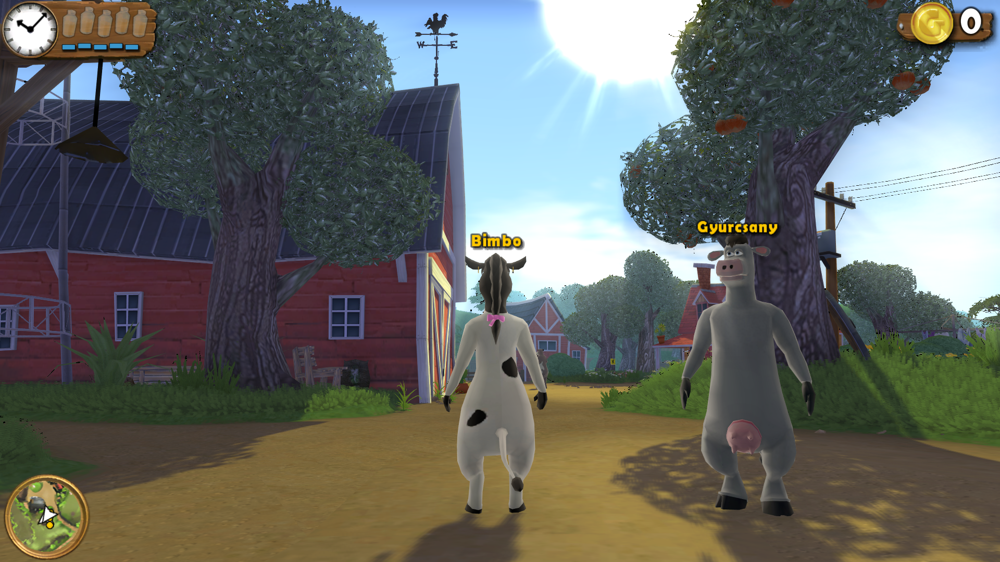

# Barnyard Remaster v5.5-lan.4 – Player names in co-op

[**Download for Windows and Linux (Proton)**](https://github.com/mannin1337/barnyard-remaster/releases/download/v5.5-lan.4/Barnyard_Remaster_v5.5_PC_Patch.zip) · [Install the patch and keep your saves](https://github.com/mannin1337/barnyard-remaster/blob/v5.5-lan.4/RemasterTools/Patch/INSTALL.md)

You can now tell who is who on the farm and whose turn you're watching. Both cows have name tags when you play together, whether you share a screen or meet over LAN. The LAN minigame scoreboards use the same names for points, turns and results.

**Choose a name.** Each LAN player can use the cow name in their save or choose a display name when launching the game. For couch co-op, you can name both players on the same computer. The gallery features Bimbo and Gyurcsany. [Windows and Linux name examples](https://github.com/mannin1337/barnyard-remaster/blob/v5.5-lan.4/RemasterTools/Patch/INSTALL.md#choose-your-co-op-names)

**Play on Linux.** Install the same patch as a Windows player, add the executable to Steam and select Proton. The guide includes desktop Linux and Steam Deck. Each player needs an installed copy of the original two-disc Barnyard PC game. Use this release on both computers to see the new scoreboards on both screens. [Linux and Steam Deck setup](https://github.com/mannin1337/barnyard-remaster/blob/v5.5-lan.4/RemasterTools/Patch/INSTALL.md#play-on-linux-with-steam-and-proton)

| File | SHA-256 |
| --- | --- |
| `Barnyard_Remaster_v5.5_PC_Patch.zip` | `032cf01d85f4d10a1d48fd30a133dd2e16a26906a7c7d5e1751eb325dcc45670` |
| `OpenBarnyard/OpenBarnyard.exe` | `68f7da117257f4d7317fd4ba19236d332470d325543f80e5e5f297464b862c1e` |
