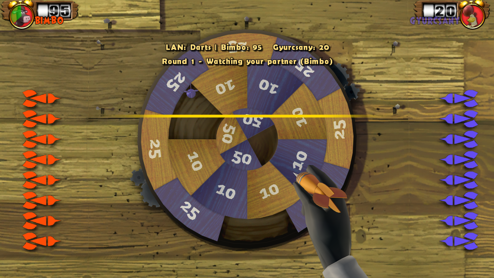

# Barnyard Remaster v5.5-lan.5 – Faster controls in LAN minigames

[**Download for Windows and Linux (Proton)**](https://github.com/mannin1337/barnyard-remaster/releases/download/v5.5-lan.5/Barnyard_Remaster_v5.5_PC_Patch.zip) · [Install the patch and carry over your saves](https://github.com/mannin1337/barnyard-remaster/blob/v5.5-lan.5/RemasterTools/Patch/INSTALL.md#carry-over-a-previous-v55-installation)

Install this version on both computers. Each player needs the original two-disc Barnyard PC game. Either player can host.

| Minigame | What changes during play |
| --- | --- |
| Darts | On the guest's turn, the first press locks the horizontal aim you saw. The vertical aim starts locally, so you can lock it with a second press while the first is still on its way to the host. |
| Barnyard Pool | The guest can aim, place the cue ball after a foul, set the power and see the start of the shot as soon as they act. The host checks the placement and resolves collisions, pockets and scores. Full-power shots also reach the ball at low host frame rates. |
| Mud Jumpers | Both players see their own jump and kick as soon as they act. The guest can also start a serve locally. Both screens use the host's ruling on hits and points. |
| Gopher Golf, Chicken Launch and Whack-a-Rac | Your computer runs your turn and sends spectator updates as soon as they are ready, up to 60 times per second. Whack-a-Rac also picks up a mouse moving along just one axis. |
| Joy Ride and score challenges | A held accelerator works when the LAN race starts. Locally earned challenge scores appear on your own scoreboard before the partner's update arrives. |

You can also rejoin after the host restarts the game. The guest now loads the new host's first minigame even if it has the same match number as the previous session.

Across all 14 minigames, all 322 measured local actions reached the renderer's frame submission point in the same update that received the input. Two Windows game instances ran with 300–370 ms of simulated round-trip delay and 3% packet loss. The 95th percentile from input dispatch to the frame submission point was 6.10 ms. The playtest report includes the full match results and the long frames observed under load. [Multiplayer playtest results](https://github.com/mannin1337/barnyard-remaster/blob/v5.5-lan.5/docs/multiplayer-testing.md)

Developers can record timings on their own computers with the `-devinputlatency` launch option. [How to measure a minigame](https://github.com/mannin1337/barnyard-remaster/blob/v5.5-lan.5/Tools/tests/netplay/README.md#test-coverage)

| File | SHA-256 |
| --- | --- |
| `Barnyard_Remaster_v5.5_PC_Patch.zip` | `d3656c3a546eb914cafe84e0ffa1480dd7eaca3df9baccb72de10cb77f1e6ee1` |
| `OpenBarnyard/OpenBarnyard.exe` | `5cbb10e6e8f3ac44281771db348d704eaf725a2425d057c7ef6ae336cd23d875` |
