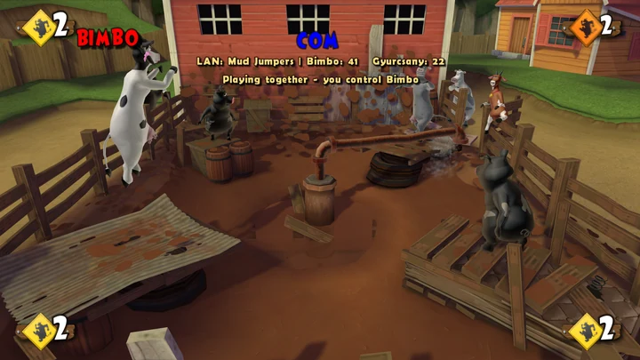

# Barnyard Remaster v5.5-lan.6 – Saved cows and clearer LAN scoreboards

[**Download for Windows and Linux (Proton)**](https://github.com/mannin1337/barnyard-remaster/releases/download/v5.5-lan.6/Barnyard_Remaster_v5.5_PC_Patch.zip) · [Install the patch and transfer your saves](https://github.com/mannin1337/barnyard-remaster/blob/v5.5-lan.6/RemasterTools/Patch/INSTALL.md#carry-over-a-previous-v55-installation)

Install the update on both computers. Each player needs the original Barnyard PC game.

- **Mud Jumpers.** Each cow brings its saved appearance into the arena. Both screens show the same breed, markings and lighting, whichever computer hosts. We also fixed a DirectX 11 skin shader issue that could make a textured cow appear flat green and purple on one screen.
- **LAN scoreboards.** Both players' names and scores are readable in Chasing Chicks and Veggie Patch Defender. The farm's partner status yields its spot while the match scoreboard is on screen and can appear again when you return.

We compared the same starting frame from two Windows game instances running on one PC. All 3,660 sampled pixels on the Angus cow's head, torso, udder and hooves matched. Both scoreboards agreed when the match ended, and both players returned to the farm. [Multiplayer test results](https://github.com/mannin1337/barnyard-remaster/blob/v5.5-lan.6/docs/multiplayer-testing.md#character-and-scoreboard-checks-in-v55-lan6)

The gallery shows all 14 activities that you could play solo in the original PC game and that we adapted for two-player LAN. Select a picture to open the full 1920 × 1080 frame. [Browse the minigames](https://github.com/mannin1337/barnyard-remaster/blob/v5.5-lan.6/README.md#minigame-gallery)

| File | SHA-256 |
| --- | --- |
| `Barnyard_Remaster_v5.5_PC_Patch.zip` | `fc1c7b7c7d687d0b9f7e8175ae14258eda5d15cc69e44ac085a1cc863c9cea87` |
| `OpenBarnyard/OpenBarnyard.exe` | `5d082b0b5cffcb4ead1d40fa1d072a663849531478c576a397ec8f2335cee934` |
